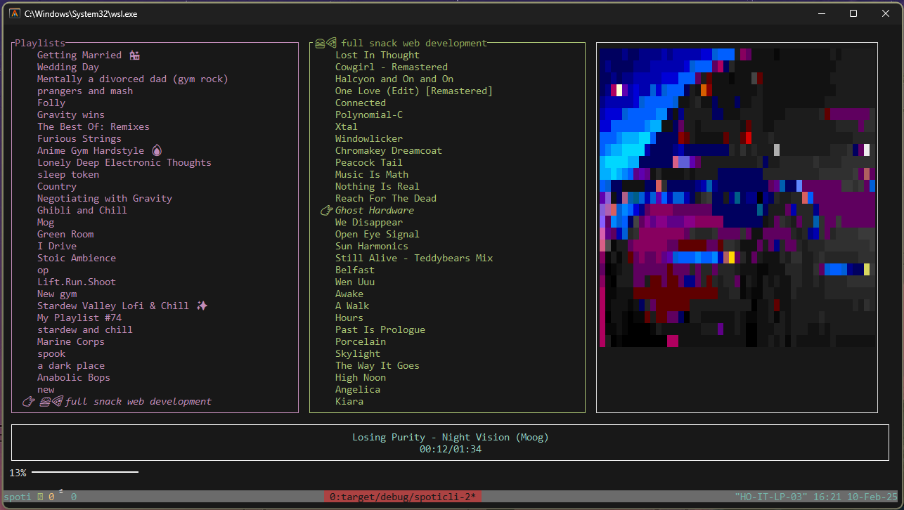

# `spoticli`: A Rust-based Spotify CLI Music Player

<!-- TABLE OF CONTENTS -->
<details>
  <summary>Table of Contents</summary>
  <ol>
    <li><a href="#purpose">Purpose</a></li>
    <li><a href="#getting-started">Getting Started</a></li>
    <li><a href="#configuration">Configuration</a></li>
    <li><a href="#usage">Usage</a></li>
  </ol>
</details>


## <a name="purpose"></a>Purpose

`spoticli` is a command-line interface (CLI) music player built using Rust. It allows users to interact with the Spotify API to manage and play their playlists directly from their terminal.  The application fetches playlist data, displays it in a TUI, and allows for track selection and playback control.  It utilizes the `reqwest` library for HTTP requests, `warp` for the OAuth server, and `tui` for the terminal user interface.



## <a name="getting-started"></a>Getting Started

1. **Prerequisites:** Ensure you have Rust installed on your system. You can install it from [https://www.rust-lang.org/tools/install](https://www.rust-lang.org/tools/install).

2. **Clone the repository:**
   ```bash
   git clone <repository_url>
   cd spoticli-2
   ```

3. **Build and Run:**
   ```bash
   cargo run
   ```


## <a name="configuration"></a>Configuration

Spoticli-2 requires a `.env` file (or `.env.local` for local development) in the project root to configure your Spotify application credentials.

You may use the `.env` file provided.

| Variable Name        | Description                       | Required | Example                               |
|-----------------------|-----------------------------------|----------|---------------------------------------|
| `SPOTIFY_CLIENT_ID`  | Your Spotify client ID            | Yes      | `your_spotify_client_id`             |
| `SPOTIFY_CLIENT_SECRET` | Your Spotify client secret        | Yes      | `your_spotify_client_secret`         |
| `SPOTIFY_CALLBACK_URL` | Your Spotify redirect URI         | Yes      | `http://localhost:3000/callback`     |
| `SPOTIFY_SCOPES`       | Space-separated list of required scopes | Yes      | `user-read-private user-read-email user-top-read user-read-playback-state user-modify-playback-state playlist-read-private playlist-read-collaborative` |
| `APP_ENV`             | Environment to use (dev/prod)      | No       | `dev`                                 |


**`.env.local` example:**

```dotenv
SPOTIFY_CLIENT_ID="your_spotify_client_id"
SPOTIFY_CLIENT_SECRET="your_spotify_client_secret"
SPOTIFY_CALLBACK_URL="http://localhost:3000/callback"
SPOTIFY_SCOPES="user-read-private user-read-email user-top-read user-read-playback-state user-modify-playback-state playlist-read-private playlist-read-collaborative"
APP_ENV="dev"
```


## <a name="usage"></a>Usage

Upon running `cargo run`, the application will guide you to a Spotify login URL. After authenticating, the application will fetch your playlists and display them in the terminal. Use the arrow keys (or `j` and `k`) to navigate through playlists and tracks. Press the spacebar or Enter to start playback of a selected track.  Press `q` to quit.
